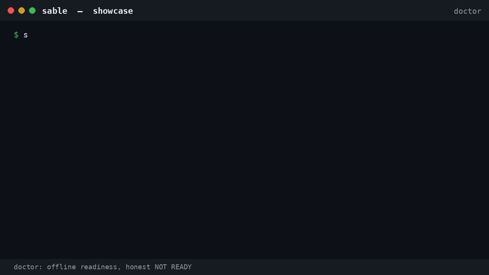
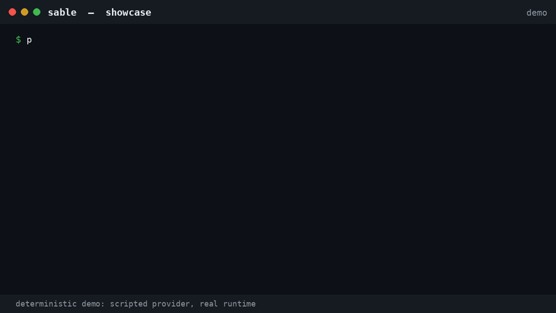
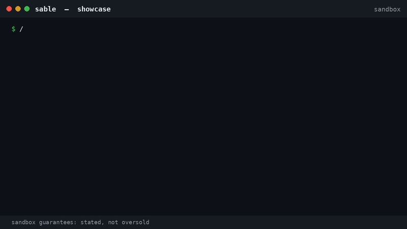
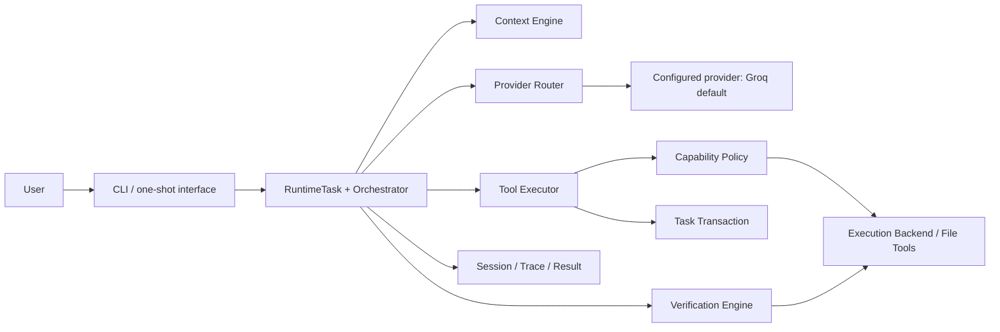

# Sable

[](https://github.com/atrx07/Sable-AI/actions/workflows/ci.yml)
[](https://github.com/atrx07/Sable-AI/actions/workflows/codeql.yml)
[](docs/platforms.md)
[](LICENSE)

**Local-first agentic coding runtime with bounded tools and deterministic
verification** — for developers who want an AI coding CLI that checks its own
work, records every edit for undo, and never lets the model approve its own
actions.

Sable is a Python CLI for agentic coding in an existing repository. A model
from the configured provider requests tools to inspect and edit code; Sable
controls which actions execute, records file-tool changes for conflict-aware
undo, and runs project checks before reporting a verified result.

Project tools, policy, transactions, and evidence run on your machine. Model
inference uses the configured hosted provider (Groq by default; OpenAI,
Anthropic, and DeepSeek are also supported, currently beta — see
[model providers](docs/providers.md)) and sends selected repository context to
that provider; **local-first does not mean offline inference**.

> **Status:** Sable 2.0.0 is released — install from PyPI with
> `pip install sableai`, or grab the wheel/sdist from
> [GitHub Releases](https://github.com/atrx07/Sable-AI/releases/tag/v2.0.0).
> CI and CodeQL pass on `main`. Groq is the default provider; the other
> providers are beta and have not had live paid-API smoke tests yet.

## Contents

- [Quick start](#quick-start)
- [Watch Sable in action](#watch-sable-in-action)
- [Why Sable](#why-sable)
- [How Sable operates](#how-sable-operates)
- [Control and safety model](#control-and-safety-model)
- [A deterministic example](#a-deterministic-example)
- [Transactions and undo](#transactions-and-undo)
- [Verification](#verification)
- [Automation](#automation)
- [Deterministic evaluation evidence](#deterministic-evaluation-evidence)
- [Quality and release evidence](#quality-and-release-evidence)
- [Current limitations](#current-limitations)
- [FAQ](#faq)
- [Documentation](#documentation)
- [Contributing](#contributing)
- [License](#license)

## Quick start

Python 3.10–3.13 is the maintained CI range. Install from PyPI:

```bash
python -m pip install sableai
sable doctor .
```

Or install from source instead:

```bash
git clone https://github.com/atrx07/Sable-AI.git && cd Sable-AI
python -m venv .venv && . .venv/bin/activate
python -m pip install -e . && sable doctor .
```

PowerShell instead of the second line: `.venv\Scripts\Activate.ps1`.
`doctor` is offline and read-only, and it correctly reports `NOT READY`
without a provider key (exit 2) — that is a passing readiness check, not a
broken install.

Then set a key and run your first read-only task:

```bash
export GROQ_API_KEY=your-key-here
sable run "Explain the project structure" . --mode plan
```

`sable .` is interactive; `sable run` performs exactly one task and exits.
Configure a provider key — `GROQ_API_KEY` (Groq, the default),
`OPENAI_API_KEY`, `ANTHROPIC_API_KEY`, or `DEEPSEEK_API_KEY` — or use the
interactive `/keys` command. See [model providers](docs/providers.md).
Keys entered through `/keys` are explicitly stored as plaintext in the
private local config; environment keys are used without being persisted.
Termux has a dedicated `bash install.sh` path; it is not a generic Linux or
Windows installer. See [platform support](docs/platforms.md) before using it.

## Watch Sable in action

**🎬 [Watch the full 48-second Sable showcase (MP4)](docs/assets/showcase/sable-main-showcase.mp4)** · [Recording notes](docs/showcase.md)

The showcase covers `sable doctor .`, interactive `/status` and `/sandbox`,
and a five-scenario deterministic evaluation.

### 1. Readiness check



Doctor correctly reports `NOT READY` when provider credentials are missing.

### 2. Deterministic evaluation



Five scripted scenarios met their declared assertions, including expected
rollback conflicts and capability denials.

### 3. Execution boundaries



Sable enforces a private HOME and sanitized environment; native execution does
**not** provide kernel, network, or process isolation.

> **About these recordings:** They use a scripted provider through the real
> Sable runtime — **not** a live AI-model coding session. No API key was used.
> Evaluation assertions passing should not be read as proof of live-model
> performance or OS-level sandboxing.

## Why Sable

Most coding CLIs hand the model a shell and report what it says it did.
Sable inverts that: the runtime owns the work, the model only requests it.

- **The runtime, not the model, owns approvals.** Capability policy,
  budgets, phase transitions, and verification outcomes are runtime-owned;
  a model response can request a tool, never mint its own approval.
- **Every edit is recorded for undo.** File-tool changes are snapshotted
  before the first mutation, and later user edits are preserved as undo
  conflicts instead of being silently overwritten.
- **A result is verified, not asserted.** Runtime-owned QUICK / AFFECTED /
  FULL checks run before a verified result is reported, with bounded repair
  only after a genuine failure.
- **Limits are stated, not hidden.** Native execution is not kernel
  isolation, and the README, security model, and sandbox output all say so.

| What you can do | How Sable supports it |
|---|---|
| Inspect a repository before editing | Bounded context selection and a read-only `plan` mode |
| Make and review code changes | Workspace-scoped file tools, diffs, and recorded transactions |
| Check a change and repair failures | Runtime-owned QUICK/AFFECTED/FULL verification and bounded repair |
| Recover file-tool edits | Fingerprint checks preserve later user edits as undo conflicts |
| Integrate with scripts | One-task CLI with schema-versioned JSON and explicit exit codes |

The [implementation evidence map](docs/evidence.md) links these capabilities to
source, regression tests, and evaluation scenarios. For future provider, local
model, IDE, and orchestration work, see the [roadmap](docs/roadmap.md).

## How Sable operates



The runtime—not the model—owns phase transitions, budgets, capability requests,
approvals, transactions, verification outcomes, and optional Git automation. A model
response may request a tool, but only the first real tool call in a turn can execute;
the model must observe that result before another action is considered.

Repository discovery and the context engine select bounded, symbol/import/test-aware
material before reasoning. Main reasoning and optional context compression use a
normalized provider route. Tool requests then pass through capability policy,
workspace/path checks, and an execution backend before results return to the loop.

[Architecture](docs/architecture.md) provides the complete component, lifecycle,
trust-boundary, verification, transaction, and evaluation diagrams.

## Control and safety model

### Enforced by Sable

- file-tool paths, including resolved symlinks, must remain inside the workspace;
- protected credential/config paths are rejected before file access;
- plan mode is a hard read-only ceiling for model-originated actions;
- elevated actions use runtime-created, exact-action allow-once/session approvals;
- normal project processes receive a private HOME and sanitized environment;
- shell execution is disabled by default and only requestable under `yolo` policy;
- independent model-turn, tool-call, verification, output, and time budgets are bounded;
- Sable file-tool mutations are snapshotted before their first change;
- required verification must pass before verified auto-commit;
- remote Git publication is capability-gated and auto-push defaults off.

### Not provided

- kernel, container, or arbitrary child-process filesystem isolation;
- arbitrary process network or process-namespace isolation;
- complete reversal of subprocess side effects;
- perfect prompt-injection resistance;
- semantic proof that code or tests are globally correct.

Repository text, source comments, model output, and tool/test output are untrusted
data. They cannot mint an approval or change its scope. This is prompt-injection
hardening backed by runtime policy, not prompt-injection immunity. Native processes
retain the Sable OS user's permissions; Termux/PRoot provides best-effort filesystem
remapping, not a kernel security boundary. Use a separately configured container,
VM, restricted OS account, or kernel sandbox for genuinely hostile code.

| Mode | Model-originated authority |
|---|---|
| `plan` | Workspace and local-Git reads; mutation cannot be approved |
| `build` | Workspace edits and restricted direct processes; destructive, network, package, raw-shell, and publish actions are denied |
| `yolo` | Elevated actions become requestable through scoped human approval; hard boundaries remain |

Read the [security model](SECURITY.md) and
[execution controls](docs/execution-security.md) before running unfamiliar projects.

## A deterministic example

This is a compact rendering of the real `coding.simple_bug` **deterministic scripted
evaluation**, not a live-model transcript. The fixture, scripted provider responses,
real Sable runtime path, and machine assertions are committed. The following
example summarizes the scenario's declared checks; it is not a fresh run report:

```text
Task: fix the calculation bug and verify it
Context: 2 required files selected from a 3-file fixture (recall 2/2)
Tool calls: 1 workspace write across 2 model turns
Changed: calculator.py
Unchanged: notes.txt, tests/test_calculator.py
Verification: PASS
Transaction: COMPLETED; rollback AVAILABLE
Outcome: TASK_PASS / VERIFICATION_PASSED
```

Inspect the [scenario catalog](evals/scenarios/m7.2-system.json),
[fixture](evals/fixtures/bug_repair), and
[assertion engine](sable/evals/assertions.py). Reproduce the suite from this
checkout with the following command (one line works in Bash and PowerShell):

```bash
python -m sable.evals --baseline evals/baselines/m7-deterministic.json --output evals/reports/generated/local
```

The [demo guide](docs/demo.md) provides focused coding, refusal, repair, transaction,
and automation walkthroughs. The [evaluation guide](evals/README.md) explains how
deterministic and live modes differ.

## Transactions and undo

Each natural-language task opens a `TaskTransaction`. Before a Sable file tool first
mutates a path, the runtime stores a bounded baseline snapshot. It records the
post-state fingerprint, verification state, checkpoints, dirty-at-start paths, and
any Sable-created commit.

```text
/txn
/txn show <transaction-id>
/undo --dry-run
/undo
```

Undo restores a path only when its current fingerprint still matches Sable's recorded
post-state. Later user edits are preserved and reported as conflicts. Undo changes
the working tree; it never resets, cleans, checks out, or rewrites Git history.
Subprocesses can change resources outside the file-tool transaction and their side
effects are not fully reversible. See [transactions](docs/transactions.md).

## Verification

Verification is a deterministic, runtime-owned gate:

| Scope | Purpose |
|---|---|
| `QUICK` | Low-cost syntax/configuration checks suitable for rapid feedback |
| `AFFECTED` | Quick checks plus heuristically selected tests related to changed files |
| `FULL` | The broadest discovered/configured project checks within the budget |

Sable discovers project tooling, constructs a typed `VerificationPlan`, runs checks
through the same execution backend, classifies structured results, and may request a
bounded repair only after a genuine failure. Repairs receive redacted diagnostics,
stop on repeated failure signatures, and are checked for likely test weakening.
Unavailable tools, timeouts, and policy blocks remain `INCOMPLETE` or `BLOCKED`; they
are never converted to a verified pass. Manifest and verification-config changes
escalate affected verification to full.

Green verification is evidence from the configured/discovered checks, not proof of
global correctness. Affected selection and integrity checks are conservative
heuristics. See [verification](docs/verification.md).

## Automation

Use `--json` only with `sable run`:

```bash
sable run "Fix the parser regression and add coverage" . --json
```

Stdout is one schema-versioned final JSON document; progress and approval prompts go
to stderr. A bounded shape is:

```json
{
  "schema_version": 1,
  "status": "completed",
  "result": "pass",
  "verified": true,
  "verification_status": "PASS",
  "changed_files": ["parser.py"],
  "transaction_id": "txn-1",
  "exit_reason": "VERIFICATION_PASSED",
  "exit_code": 0
}
```

Consumers should check both `schema_version` and process exit code. Stable codes
distinguish success, usage/configuration, verification, policy denial, backend
unavailability, provider failure, internal failure, and cancellation. The complete
schema and exit-code table are in the [CLI contract](docs/cli.md).

## Deterministic evaluation evidence

The [committed baseline](evals/baselines/m7-deterministic.json) contains 56 scenarios
and requires all completed scenarios to pass their declared assertions. It permits
at most one platform skip, solely for `security.symlink_escape`. A host with symlink
support executes all 53; a host without it can complete 52 and report one skip.

Run the command above to obtain the current `eval-report.md` and `eval-results.json`.
Reports record the source commit, host, mode, failures, skips, and rate denominators.
The [deterministic CI job](.github/workflows/ci.yml) runs the same baseline command.
A configured gate is a requirement; a passing result must come from a recorded run.

These scenarios use scripted provider responses with the real runtime components.
They check behavior under controlled fixtures, including coding, repair, refusal,
rollback, and test-integrity attacks. They do not measure arbitrary coding success
or live-model reliability. Live evaluation is separate, opt-in, nondeterministic,
and may consume quota. See the [evaluation methodology](evals/README.md).

## Quality and release evidence

The repository gates Python 3.10–3.13 on Linux, performs an installed-wheel smoke on
Windows/Python 3.13, enforces Ruff formatting/lint and an 82% statement-coverage
floor, audits runtime dependencies, runs Bandit and CodeQL, preserves the committed baseline,
and installs both built wheel and sdist in clean environments. Release automation is
manual, defaults to no publication, and re-downloads artifacts to verify checksums.

No public tag, GitHub Release, or PyPI publication is implied. See
[quality policy](docs/quality.md) and [release procedure](docs/releasing.md).

## Current limitations

- OpenAI, Anthropic, and DeepSeek providers are beta: mocked-test coverage only,
  no live paid-API smoke tests yet (see [model providers](docs/providers.md)).
  AgentRouter, local-model, IDE/server, and multi-agent support remain proposed
  work, not shipped features.
- Affected-test selection and verification-integrity checks are heuristic.
- PRoot is best-effort remapping; native child processes retain OS-user permissions.
- Arbitrary process filesystem, network, and namespace isolation are not provided.
- Blocking provider calls observe cancellation only at host/library-supported points.
- Project-wide static type checking is not a blocking gate.
- Android runtime validation requires manual evidence; macOS has no dedicated CI.
- Live-model evaluation is nondeterministic and excluded from ordinary CI.
- Keys deliberately saved with `/keys` remain plaintext in the private local config.

## FAQ

**Do I need an API key to try Sable?**
No for `sable doctor .` and the scripted deterministic demos — those are
offline. Yes for any live task: set `GROQ_API_KEY` (or another provider key)
first. See [model providers](docs/providers.md).

**Is Sable offline?**
Its tools, policy, transactions, and verification run on your machine, but
model inference is hosted: selected repository context is sent to the
configured provider. Local-first does not mean offline inference.

**Why does `doctor` say NOT READY?**
Almost always: no provider key is configured. That is the documented,
correct result (exit 2), not a broken install. See
[troubleshooting](docs/troubleshooting.md).

**Does Sable sandbox the code it runs?**
Not at kernel level. Native processes keep the OS user's permissions, with
a private HOME and sanitized environment; Termux/PRoot is best-effort
remapping only. Use a container, VM, or restricted account for genuinely
hostile code. See [execution controls](docs/execution-security.md).

**Which providers work?**
Groq by default. OpenAI, Anthropic, and DeepSeek are supported but beta:
mocked-test coverage only, no live paid-API smoke tests yet. See
[model providers](docs/providers.md).

## Documentation

| Area | Guide |
|---|---|
| CLI, automation schema, exit codes | [docs/cli.md](docs/cli.md) |
| Model providers (Groq, OpenAI, Anthropic, DeepSeek) | [docs/providers.md](docs/providers.md) |
| Troubleshooting and FAQ | [docs/troubleshooting.md](docs/troubleshooting.md) |
| Architecture and task lifecycle | [docs/architecture.md](docs/architecture.md) |
| Claims mapped to implementation and tests | [docs/evidence.md](docs/evidence.md) |
| Runtime state and routing | [docs/runtime.md](docs/runtime.md) |
| Security threat model | [SECURITY.md](SECURITY.md) |
| Execution capabilities/backends | [docs/execution-security.md](docs/execution-security.md) |
| Transactions and recovery | [docs/transactions.md](docs/transactions.md) |
| Context selection | [docs/context-engine.md](docs/context-engine.md) |
| Sessions and traces | [docs/sessions.md](docs/sessions.md) |
| Verification | [docs/verification.md](docs/verification.md) |
| Evaluations | [evals/README.md](evals/README.md) |
| Reproducible demos | [docs/demo.md](docs/demo.md) |
| Platforms and installation | [docs/platforms.md](docs/platforms.md) |
| Quality and packaging | [docs/quality.md](docs/quality.md) |
| Release process | [docs/releasing.md](docs/releasing.md) |
| 2.0.0 release-note draft | [docs/release-notes-draft.md](docs/release-notes-draft.md) |
| Launch copy and metadata proposals | [docs/launch-kit.md](docs/launch-kit.md) |
| Completed v2 foundation and proposed next steps | [docs/roadmap.md](docs/roadmap.md) |
| Contribution workflow | [CONTRIBUTING.md](CONTRIBUTING.md) |
| Support | [SUPPORT.md](SUPPORT.md) |

## Contributing

Start with [CONTRIBUTING.md](CONTRIBUTING.md). It documents the editable environment,
canonical `python -m scripts.quality` gate, synthetic fixture rules, evaluation
expectations, and fork/PR workflow. Security-sensitive changes should also follow
[SECURITY.md](SECURITY.md).

## License

[MIT](LICENSE)
