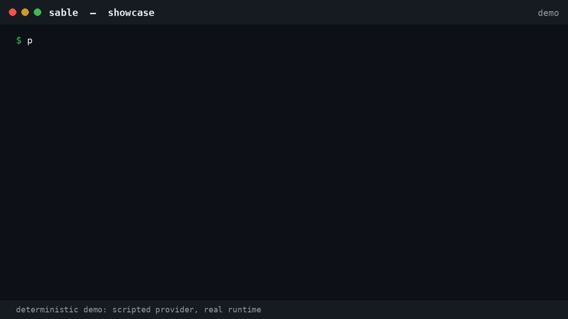

# Sable showcase — recorded walkthrough and GIFs

These clips were recorded on **4 November 2026** from Sable 2.0.0 source at
commit [`d6695d5`](https://github.com/atrx07/Sable-AI/commit/d6695d573a8e7d73e4355cc986b76772be4fab2b).

**This is not a recording of a live model repairing a repository.** The
evaluation uses a scripted provider through Sable's real runtime. No live
model or API key was used in the recordings.

## Watch

[**Full 48-second showcase (MP4)**](assets/showcase/sable-main-showcase.mp4)
— 1280 × 720, H.264, silent. It shows a title card, `sable doctor .`,
interactive `/status` and `/sandbox`, a deterministic five-scenario demo,
and a closing card.

| Clip | What you will see |
| --- | --- |
| [Doctor readiness](assets/showcase/gif-doctor.gif) | 17 passes, with `API key: not configured` and `NOT READY` |
| [Five-scenario evaluation](assets/showcase/gif-eval.gif) | 5/5 scripted scenarios meet their assertions |
| [Execution capabilities](assets/showcase/gif-sandbox.gif) | Private HOME and environment sanitization enforced; namespace, network and process isolation `NOT_SUPPORTED` |

## How to interpret the footage

- The terminal output was captured from real `sable --version`, `sable doctor .`,
  interactive `/status` / `/sandbox`, and deterministic evaluation commands.
  Only the absolute workspace path was shortened to `~/demo-proj` for readability.
- The missing API key is deliberate. Doctor correctly reports `NOT READY`;
  the recording is **not** evidence of a live-provider integration test.
- The 5/5 outcome refers to **declared evaluation assertions**. In particular,
  `ROLLBACK_CONFLICT` and `CAPABILITY_DENIED` are expected correct behaviors
  in their scenarios, not successful coding task completions.
- These silent videos are illustrative recordings, **not** proof of broad
  real-world model coding performance or operating-system isolation.
- The media package did not include its original rendering source/capture
  scripts, so the videos themselves are not reproducible from this repository.
  For reproducible scripted scenarios and current run evidence, use
  [`docs/demo.md`](demo.md) and [the evaluation guide](../evals/README.md).

## Media files

- [`sable-main-showcase.mp4`](assets/showcase/sable-main-showcase.mp4)
- [`gif-doctor.gif`](assets/showcase/gif-doctor.gif)
- [`gif-eval.gif`](assets/showcase/gif-eval.gif)
- [`gif-sandbox.gif`](assets/showcase/gif-sandbox.gif)

When updating these, re-record and check the actual CLI output against the
current commit. Do not silently relabel scripted evaluations as live-model runs.
